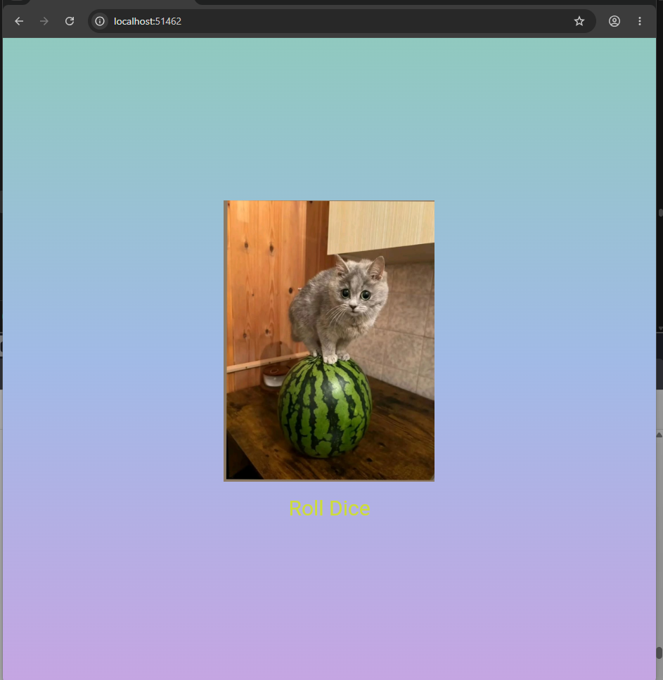

# Лабораторная работа №4-5. Flutter: структура UI и компонентный подход

**Студент:** Беляева Виктория, *группа* ИСП-241
**Дата сдачи:** 21.11.2026 (время 4:44!!!)
**Репозиторий:** https://github.com/bleb-le/Flutter_Widgets

## Что изучили
- строить интерфейс как дерево виджетов
- создавать собственные виджеты-классы и выносить их в отдельные файлы!
- передавать данные в виджеты через параметры конструктора!

## Скриншот

## Ответы на вопросы

**1. Зачем выносить виджеты в отдельные файлы?**
так проще ориентироваться в проекте, искать нужный виджет и переиспользовать его, если держать всё в main.dart, файл разрастается, дерево виджетов трудно читать, растёт риск ошибок...!!

**2. Что такое BuildContext?**
объект с информацией о положении виджета в дереве, через него виджет обращается к родителям.. flutter сам передаёт его в build() при каждой перерисовке!!!

**3. Чем StatelessWidget отличается от StatefulWidget?**
StatelessWidget не хранит изменяемое состояние, зависит только от параметров! StatefulWidget хранит состояние в объекте State и перерисовывается по setState()!

**4. Почему Random() создаётся на уровне файла?**
чтобы не создавать новый генератор при каждом нажатии кнопки, один объект создаётся один раз и переиспользуется